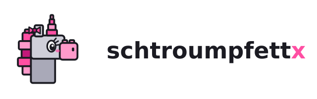

<picture>
  <source media="(prefers-color-scheme: dark)" srcset="assets/lockup-sombre.svg">
  
</picture>

**Ingénieure cybersécurité · IA de confiance · cryptographie post-quantique · souveraineté numérique**

🇫🇷 Je reconstruis toutes mes bases, de Linux à la PQC, et je documente tout en public.

🇬🇧 Rebuilding every foundation, from Linux to PQC, and documenting it all in public.

- Labo hebdomadaire : [defense-tech-lab](https://github.com/schtroumpfettx/defense-tech-lab)
- Blog : bientôt sur schtroumpfettx.fr
